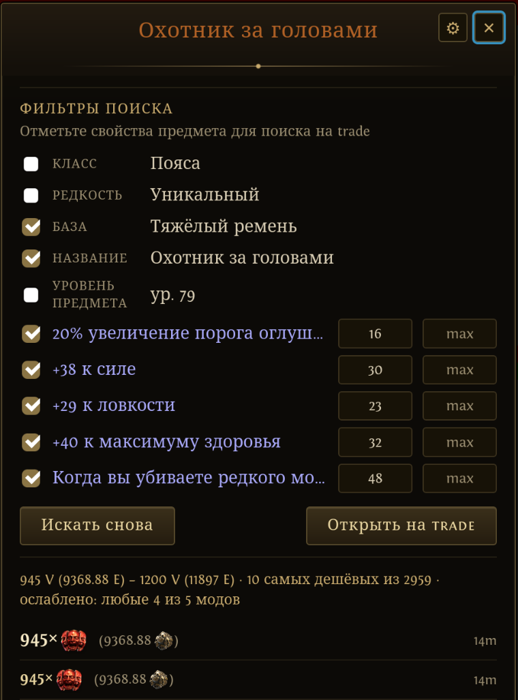

# PoE2 Overlay — Wayland, русский клиент, геймпад

Оверлей цен для **Path of Exile 2** под **KDE Plasma 6 / KWin Wayland**: рисуется поверх
полноэкранной игры (Steam Proton) через `wlr-layer-shell`, копирует предмет под курсором
и оценивает его по официальному trade2 API GGG и poe.ninja.

Это форк [andre-lund/poe2-overlay](https://github.com/andre-lund/poe2-overlay) с
поддержкой локализованных клиентов игры (в первую очередь русского), управлением с
геймпада и рядом доработок поиска. Описание оригинала — в [README.en.md](README.en.md).



## Чем отличается от оригинала

**Языки**
- Работает с копиями предметов из клиентов на **русском, немецком, французском,
  испанском, португальском, японском и корейском** (тайский клиент копирует по-английски).
  Язык определяется автоматически; копия переводится в английский формат перед оценкой
  по справочникам trade2 самой GGG, так что поиск идёт по тем же id, что и на сайте.
- **Язык интерфейса** выбирается в настройках (⚙): «Авто» — как в игре, или любой из
  девяти языков trade2. Переведены карточка, сообщения, таблица цен (названия предметов и
  категорий) и оценка опасности путевых камней.
- Если язык интерфейса совпадает с языком игры, моды, класс и база в карточке показываются
  так, как написаны в игре.

**Геймпад** (пока карточка открыта, ввод с геймпада в игру не уходит)
- Правый стик — прокрутка, крестовина вверх/вниз — прокрутка шагами.
- Левый стик — выбор строки фильтра, **X** или **A** — снять/поставить галочку или нажать
  «Искать снова». **B** — закрыть.
- Работает и со Steam Input (виртуальный геймпад Steam блокируется, физический читается).

**Поиск и карточка**
- **Ослабление пустого поиска.** Если точный поиск ничего не нашёл, оверлей по очереди
  снимает моды рун и зачарований, затем ищет «любые N−1 из N модов», затем «N−2 из N».
  В карточке видно, какое ослабление сработало.
- **Иконки валют** как в игре: `945× [иконка]` с пересчётом в Exalted.
- Кнопка **«Открыть на trade»** — тот же поиск на сайте, на домене языка интерфейса.
- **Лига** выбирается в настройках («Авто» — текущая лига сезона) и запоминается.
- Кнопки ✕ и ⚙ закреплены и не уезжают при прокрутке.

**Исправления**
- Предмет, который персонаж не может надеть («Вы не можете использовать этот предмет…»),
  раньше ломал поиск — строка-предупреждение принималась за имя предмета.

Исправление и локализация предложены автору оригинала:
[#2](https://github.com/andre-lund/poe2-overlay/pull/2),
[#1](https://github.com/andre-lund/poe2-overlay/pull/1).

## Управление

| Клавиши | Действие |
|---|---|
| `Ctrl+Alt+D` | Цена предмета под курсором (над путевым камнем — оценка опасности) |
| `Ctrl+Alt+F` | Таблица цен poe.ninja (руны, валюта, сущности, уники…) |
| `Ctrl+Alt+X`, `✕`, `Esc` | Скрыть оверлей |
| ⚙ на карточке | Язык интерфейса и лига |

Проверку цены можно вызвать и командой `poe2-overlay --price-check` — например, из своего
скрипта или с кнопки геймпада.

## Установка (CachyOS / Arch, KDE Plasma 6 Wayland)

```bash
sudo pacman -S --needed webkit2gtk-4.1 gtk3 gtk-layer-shell base-devel rustup nodejs npm \
    wl-clipboard ydotool
rustup default stable
systemctl --user enable --now ydotool   # без демона ydotool Ctrl+C в игру не доходит

npm install
npx tauri build --no-bundle   # только бинарник; полный npm run tauri:build ещё и пакует AppImage/deb/rpm
./packaging/install.sh        # бинарник + горячие клавиши KDE + автозапуск
```

После установки перелогиньтесь, чтобы KDE подхватил горячие клавиши.

Нужен доступ к `/dev/uinput` (обычно уже есть через ACL сессии; иначе — правило
`packaging/99-poe2-overlay-uinput.rules`). Геймпад читается из `/dev/input/event*` — для
геймпадов systemd обычно выдаёт доступ сам.

Подробнее (права, смена клавиш, удаление) — в [docs/INSTALL.md](docs/INSTALL.md) (англ.).

## Если что-то не так

- **Карточка рисуется кусками или пропадает, пока на неё не навести мышь** (замечено на
  AMD): включите DMA-BUF-рендерер WebKit — переустановите с `POE2_DMABUF=1 ./packaging/install.sh`
  или запускайте с `WEBKIT_DISABLE_DMABUF_RENDERER=0`. У автора оригинала WebKit с ним
  падал, поэтому по умолчанию он выключен.
- **«Нет предмета» при наведённом курсоре** — проверьте, что запущен `ydotool`
  (`systemctl --user status ydotool`) и установлен `wl-clipboard`.
- `PROTON_ENABLE_WAYLAND=1` в параметрах запуска игры оверлею не мешает (и может убрать
  микрофризы).
- Лог: `journalctl --user` (или вывод `poe2-overlay` в терминале).

## Лицензия

**GPL-3.0-or-later** (см. `LICENSE`), как и у оригинала. Ядро оценки основано на
[PathofTrading](https://github.com/brendancohan/PathofTrading) (GPLv3), подробности — в
[README.en.md](README.en.md). Строки интерфейса игры для разных языков взяты из
[Exiled-Exchange-2](https://github.com/Kvan7/Exiled-Exchange-2) (MIT), соответствие баз и
классов — из [RePoE](https://github.com/repoe-fork/repoe).

Не связан с Grinding Gear Games. Используется публичный trade2 API и poe.ninja; запросы к
GGG сами притормаживают по заголовкам `X-Rate-Limit`.
